# Hush user guide

Everything Hush does, in the order you'll meet it. For what Hush is and how to install it, see the [README](https://github.com/IrtizaNasar/Hush#readme); to download it, [Hush.dmg](https://github.com/IrtizaNasar/Hush/releases/latest/download/Hush.dmg).

**Contents:** [Setting up](#setting-up) · [Recording calls](#recording-calls) · [Live captions](#live-captions) · [Dictation](#dictation) · [The command bar](#the-command-bar) · [Files and links](#files-and-links) · [The library](#the-library) · [Ask Claude (MCP)](#ask-claude-mcp) · [Vocabulary](#vocabulary) · [Settings](#settings) · [Keyboard shortcuts](#keyboard-shortcuts) · [Privacy in detail](#privacy-in-detail) · [Limits](#limits)

## Setting up

The first time Hush opens, the Welcome window walks you through seven steps. Most of the time is the models downloading.

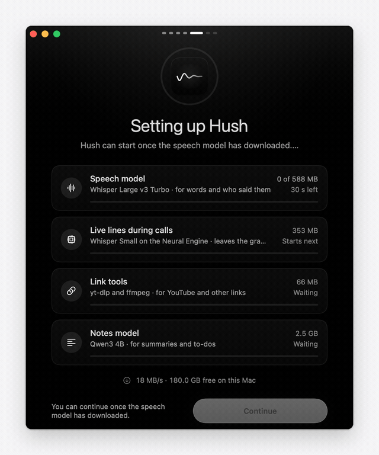

1. **Welcome.** Press **Get Started**.
2. **Private by design.** Three promises before Hush asks to listen: no analytics, every connection listed, shared with no app unless you say.
3. **Let Hush listen.** Allow the **Microphone** and **System audio** (both required), and **Accessibility** if you want dictation to type for you and calls named from the meeting window.
4. **Choose your models.** A speech model and a notes model, with the ones that suit your Mac suggested. Turn off the switch beside **Notes** if you don't want them; you can download the notes model later.
5. **Setting up Hush.** The downloads come in one after another, each showing how much is in and how long is left: the speech model with two small speaker models, Whisper Small for live lines during calls, the link tools for YouTube and other links, and the notes model. **Continue** unlocks once the speech model is in. The rest carries on in the background, even with the window closed, and a download that fails tries again by itself.
6. **Your shortcuts.** ⌃⇧Space opens the command bar and ⌃⌥D dictates, from any app. Press one to try it; click it and press new keys to change it.
7. **You're all set.** Press **Open Library**.

To see Welcome again, choose **Show Welcome** from the menu bar icon's menu or the **Help** menu.

## Recording calls

Join a call and Hush offers to record it. It records your microphone and what your Mac plays separately, so your voice and theirs never mix; on speakers rather than headphones, it takes their voices out of your microphone. No bot joins the call, there's no audio driver to install, and Hush never mutes or changes the microphone in your call app.

Hush recognises Microsoft Teams, Zoom, Webex, Slack, FaceTime, Discord, WhatsApp, Skype, GoTo Meeting and RingCentral, and calls in Chrome, Safari, Arc, Edge, Firefox and Brave, such as Google Meet. Calls through your iPhone show as Phone call. For anything else, such as a meeting in a room or a video, use **Start Recording** (⌘R): it records your microphone and everything your Mac plays.

### The notch panel

Hush shows itself in a small black panel around your Mac's notch (at the top centre of the screen on a Mac without one).

<table>
<tr>
<td width="42%" align="center">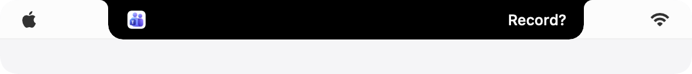 <b>Strip</b></td>
<td width="58%" align="center">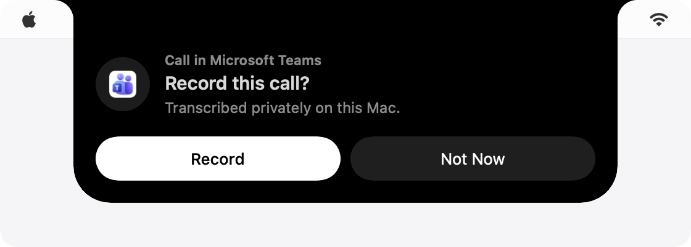 <b>Card</b></td>
</tr>
</table>

The **strip** wraps round the notch: an icon on the left, a word or a timer on the right. The **card** opens when you point at the strip, and by itself when something needs you.

### The offer

When an app starts using your microphone, the card asks **Record this call?** **Record** starts recording; **Not Now** keeps Hush quiet until that app lets go of the microphone. Nothing is recorded until you say so.

To record an app's calls without being asked, add it under **Record automatically** in **Settings › General**. To stop the offers altogether, turn off **Offer to record when a call starts**.

### While it records

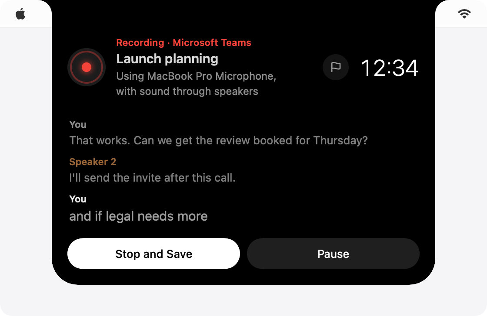

The card shows the call's name, what Hush is hearing, a timer, and each sentence as it's said, with who said it. The strip keeps a red dot, a level meter and the timer, so you can leave the card closed.

Teams and Google Meet put the meeting's name in their window, and a Slack huddle its channel: with Accessibility allowed, Hush reads that one title as the call starts and names the recording after it. Zoom and FaceTime windows say only the app's name, so those calls are named from their notes instead.

The live sentences are a first draft. During calls they come from Whisper Small on the Neural Engine, which leaves the graphics chip to the call; once the call is over, Hush goes over the whole recording with your main model.

- **Flag a moment** with ⌃⌥F in any app, or the flag beside the timer, to find that sentence again later.
- **Pause** (⇧⌘R) stops recording until you press **Resume**. If your Mac sleeps, Hush pauses by itself and says so when you're back.
- **Hide for This Session**, from the strip's right-click menu or the menu bar icon, takes the panel off the notch for this recording. Hush keeps recording, and the menu bar icon keeps the timer, Pause and Stop. Use it when another notch app, such as Loophole, needs the notch, or when you'd rather not see the strip. The panel comes back when the call ends or something needs you; **Show Island** brings it back sooner.

### Stopping

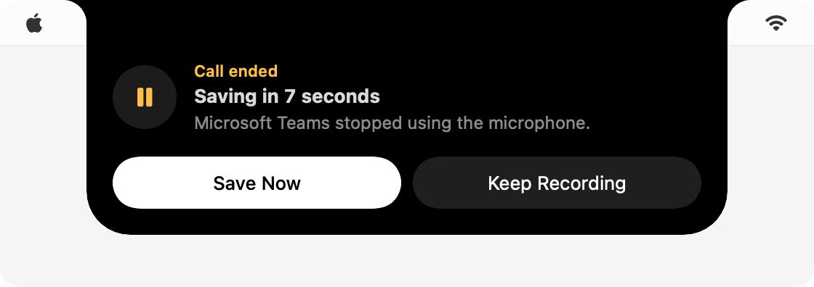

**Stop and Save** (⌘R) ends the recording. The card says **Saved**, with the call's length, and offers **Open Transcript** and **Copy Transcript**. Quitting Hush while it records asks first, and keeps what's been recorded.

When the call app lets go of the microphone, the card counts down from 10 seconds, then stops and saves; **Keep Recording** carries on. If you've only muted and the call is still playing, Hush waits until the others have been quiet for 2 minutes. If nobody says anything for 15 minutes, the card asks whether the meeting is over. To always stop by hand, turn off **Stop recording when the call ends** in **Settings › General**.

### After the call

Hush finishes the transcript on your Mac: it transcribes the whole recording again for better accuracy, works out who said what, and writes the notes. This takes about 6 minutes per hour of call with Whisper Large v3 Turbo. You can close everything meanwhile; Hush keeps your Mac awake until it's done. In the library, an amber ring beside the transcript and a banner over its words show how far it has got, with **Stop**.

This work runs at half speed while you're using another app, so your Mac stays responsive, and at full speed when Hush is in front or you've stepped away for a minute. **Settings › General › Background work** turns that off. If another call starts meanwhile, the work waits for it to end.

### When something's wrong

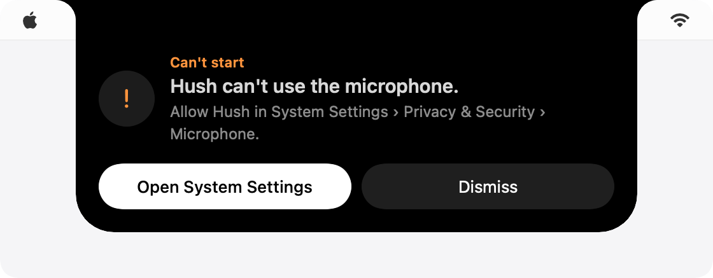

If Hush can't start, the card says why and offers the fix: **Open Privacy Settings** when it can't use the microphone, **Download Model** when the speech model isn't in, **Storage Settings** when the disk is almost full.

During a call it also warns, with a fix, when your microphone is silent, when the lid is closed (your Mac's own microphone is off then), and when it can't hear the other side. If the microphone or the call's sound drops out, Hush reconnects it and keeps recording. If the disk is nearly full, Hush stops and saves before it runs out.

## Live captions

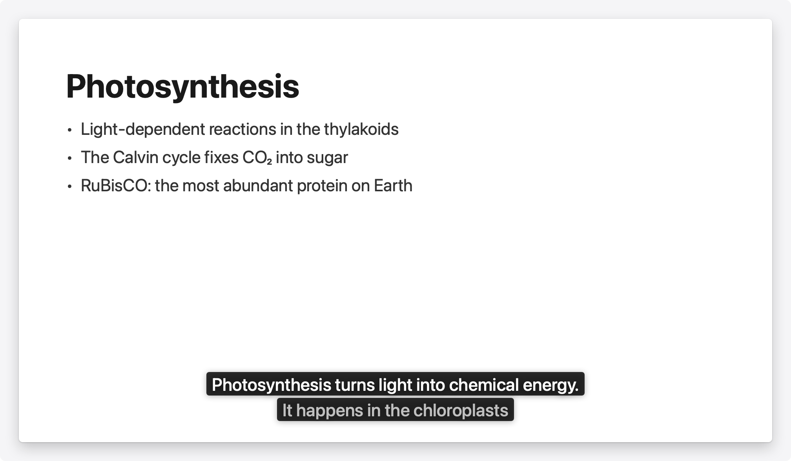

**Present with Live Captions**, from the command bar or the menu bar icon, shows what you say as captions on the audience's screen, above Keynote, PowerPoint or Google Slides. With two screens, the captions go to the one without the menu bar, such as a projector.

The captions roll up in two lines and fade when you pause. Hush waits a moment before showing the last words of a sentence, so words never change once they're on screen; they trail your voice by about a second and a half.

While you present, the notch panel shows **Live captions**, with **Stop** and **Pause**, and the menu bar wave turns blue. Nothing is saved unless you turn on **Save presentations as transcripts**, in **Settings › Presenting**, which also sets the screen, the text size, the alignment and the position, and whether to caption a video you play during the talk.

## Dictation

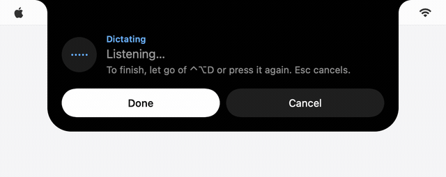

Hold ⌃⌥D, speak and let go: your words appear where your cursor is, in any app. For longer dictation, tap ⌃⌥D once to start and again to finish. Esc cancels. While you speak, the card shows the words as they form, with **Done** and **Cancel**.

When you finish, Hush types the text into the app you were using and the card says **Inserted**. The text stays on the clipboard too, so ⌘V pastes it again. Typing into other apps needs Accessibility; without it, Hush copies the text and the card says **Copied**.

Every dictation is kept in the library under **Dictations**. Dictation uses your microphone only, and what you dictate during a call is left out of the call's transcript. Change the shortcut, or turn dictation off, in **Settings › Dictation**; if macOS or another app already uses the shortcut, Settings says so.

## The command bar

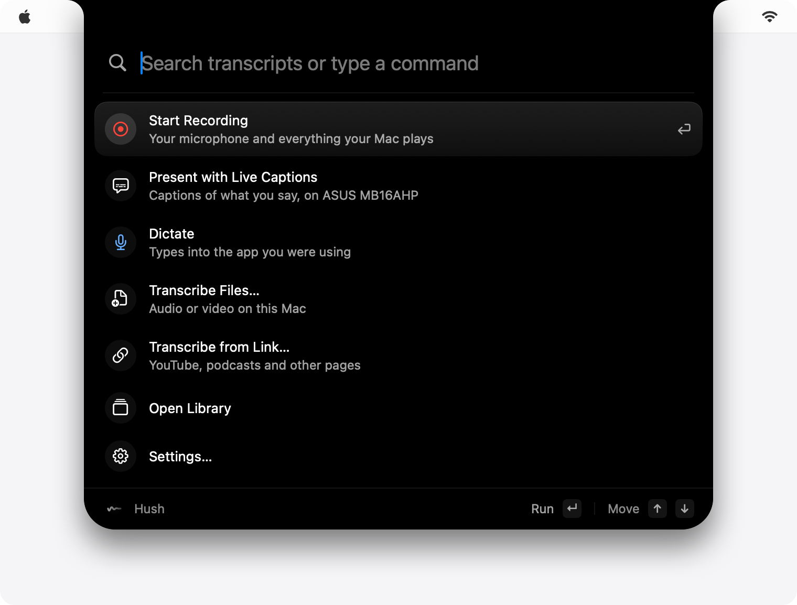

Press ⌃⇧Space in any app. The command bar drops out of the notch on the screen you're working on, without taking you out of the app you're in. ↑ and ↓ move, Return runs, and Esc or a click outside closes it.

From it: **Start Recording** (and while recording, **Stop and Save**, **Pause Recording** and **Flag This Moment**), **Present with Live Captions**, **Dictate**, **Transcribe Files…**, **Transcribe from Link…**, **Open Library** and **Settings…**. Type the start of a word to find a command: "rec" finds Start Recording.

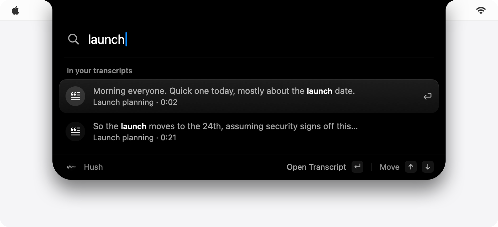

Type two letters or more and it also searches what was said in every transcript, showing up to six moments. Return opens the transcript at that sentence. Change the shortcut in **Settings › General**.

## Files and links

**Files.** Drop audio or video on the library window, choose **Transcribe Files…** (⌘O), open a file with Hush from Finder, or drop it on Hush's Dock icon. Files dropped while a folder is open go into that folder. Hush reads MP3, M4A, WAV, AIFF, FLAC, MP4 and MOV, and with its link tools, WebM, MKV, Ogg, Opus, WMA and AVI too.

Files stay where they are. Hush follows a file if you move or rename it, and keeps a small copy of its sound, so you can still play it back and transcribe it again if you delete the original. The **Files** section of the sidebar shows progress, and a notification says when a transcript is ready.

**A watched folder.** Choose one in **Settings › Storage › Watched folder**, and Hush transcribes the audio and video added to it, saving each transcript beside its file in the format you choose.

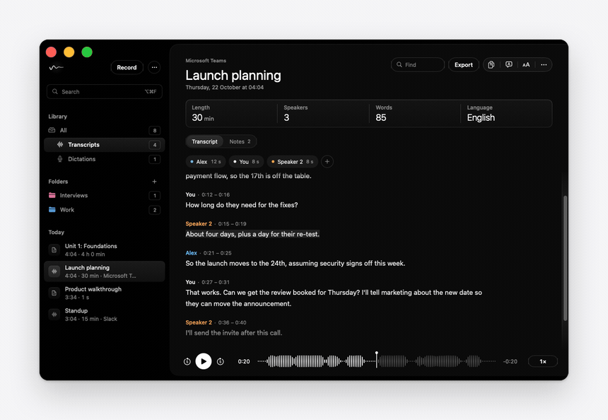

**Links.** Choose **Transcribe from Link…** (⇧⌘L), paste a link from YouTube, Vimeo, Panopto, a podcast or most video pages, and press **Transcribe**. Hush fetches the audio, then transcribes it on your Mac.

For a page only you can see, like your university's Panopto, set **Signed-in pages** to **Sign In First**: a window opens, you sign in as usual, open the video and press **Transcribe This Page**. You stay signed in, in Hush only. If you're signed in to the site in Chrome, Safari, Firefox, Edge or Brave, you can use that browser's sign-in instead. Panopto links choose Sign In First by themselves.

Some sites protect their videos so they can't be downloaded. Play the video on your Mac and use **Start Recording** instead.

Links need two small free tools (yt-dlp and ffmpeg, 66 MB together). Hush downloads them in setup, or when you first paste a link, and keeps them up to date as sites change.

## The library

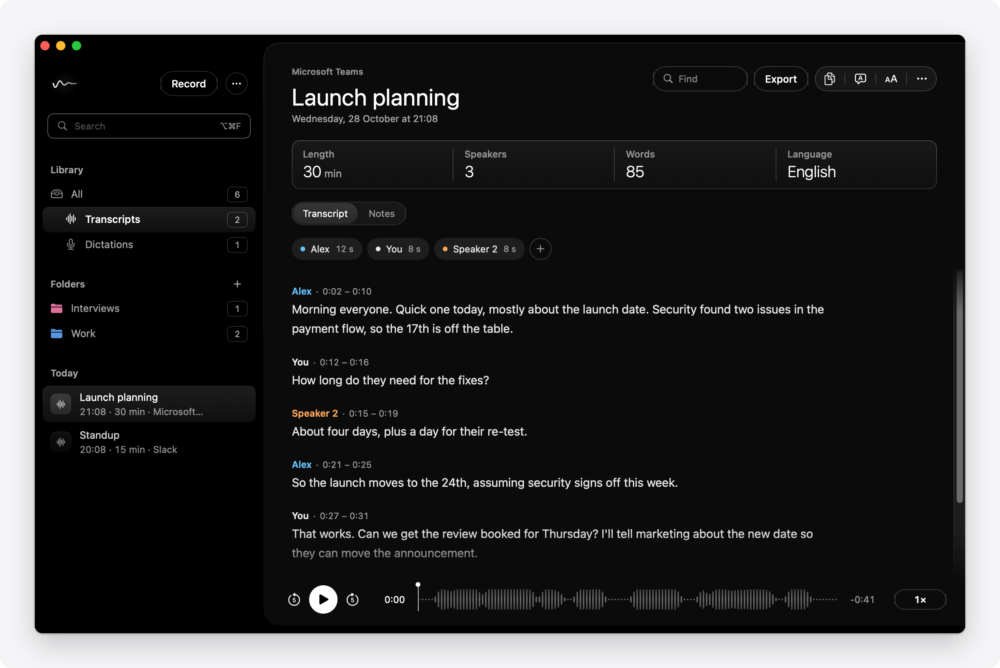

Everything you record, transcribe and dictate is kept in the library. Open it with **Open Library** (⌘0), from the menu bar icon. The sidebar lists your **Transcripts** and **Dictations** by date, with your folders below.

### Transcripts

A transcript shows who said what. At the top are its length, speakers, words and language, and two tabs: **Transcript** and **Notes** (⌘1 and ⌘2).

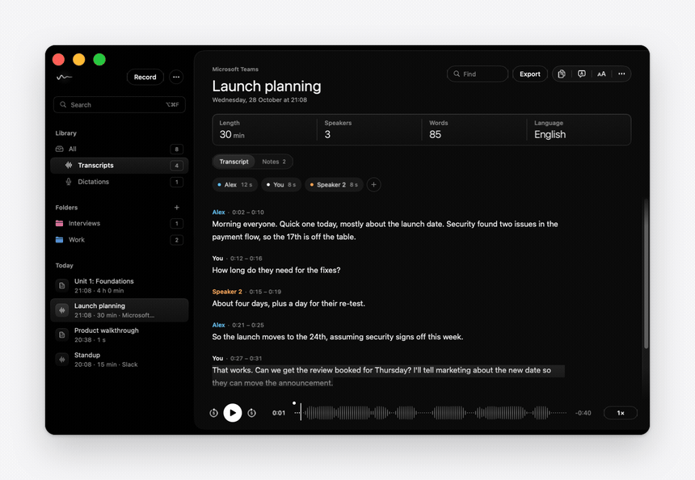

- **Play it back.** The player bar plays the recording: drag along the waveform, skip 5 seconds, or play from 0.75× to 2×. Space plays and pauses. The sentence playing is lit, and the transcript keeps up with it.
- **Read it your way.** In **View options**, choose **Paragraphs**, **Conversation** (you on the right, everyone else on the left) or **Lines** (one sentence a line, with its time). Show timestamps, hide filler words such as um and uh, and change the text size.
- **Fix a sentence.** Click it and press Return to edit. Press 1 to 9 to give it to that speaker. ⌘Z undoes any change.
- **Rename it.** Click the title and type.
- **Transcribe Again**, in **⋯ More**, rebuilds the transcript from the audio with the model and vocabulary you use now, for example after adding names that came out wrong or downloading a more accurate model. Hush asks first, as the transcript is replaced; **Stop** puts back the transcript as it was.
- **Open in New Window** gives a transcript a window of its own.

### Speakers

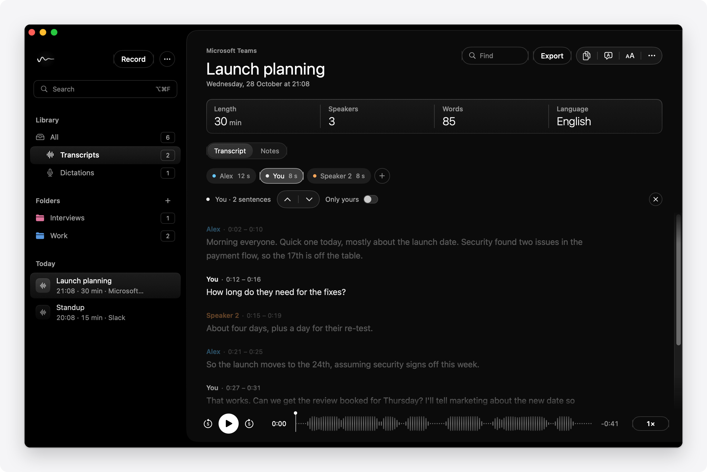

Hush labels each voice: You, then Speaker 1, Speaker 2 and so on. The chips above the transcript list everyone, with how long each spoke.

- **Name a speaker** by double-clicking their chip. Hush remembers the voice and uses that name when it hears it again, in any transcript.
- **Highlight a speaker** by clicking their chip: everyone else dims, and you can step through their sentences or show only theirs.
- **This Is Me**, from a chip's right-click menu, teaches Hush your voice, so it labels you You in rooms and files too.
- **Look for More Speakers**, in the chips' + menu, listens again when two voices were taken for one. **Find Speakers Again** sorts every line afresh when the transcript shows people who weren't there; lines you gave a speaker by hand stay theirs.
- **Merge Into** joins two speakers who are really one person.

Your voice and the voices Hush remembers are in **Settings › Voices**, kept as voiceprints (a short summary of how someone sounds) rather than recordings.

### Notes and to-dos

After every call, file and link, the notes model writes a summary, the key points and a to-do list with who's doing what, in the **Notes** tab. The notes say *you* for what you said and name everyone else.

- **Back to the source.** Each to-do shows the time it came from. Click it and the transcript opens at that sentence.
- **Edit anything** in place: add a point or a to-do, tick to-dos off, or assign them.
- **Copy** copies the notes as Markdown.
- **Kept up to date.** If you edit the transcript later, Hush offers to **Rewrite** the notes. Notes you've edited by hand are never rewritten without asking.
- **A better title.** A transcript still called something like "Zoom call" takes the title its notes suggest. A title you typed is kept.

Notes for an hour-long call take about 2 minutes with Qwen3 4B on an M1 Pro, and about twice that with Qwen3 8B. They aren't written for dictations or transcripts under 40 words. Turn off **Write notes automatically** in **Settings › Notes** to write them only when you press **Write Notes** (⌘↩).

### Note styles

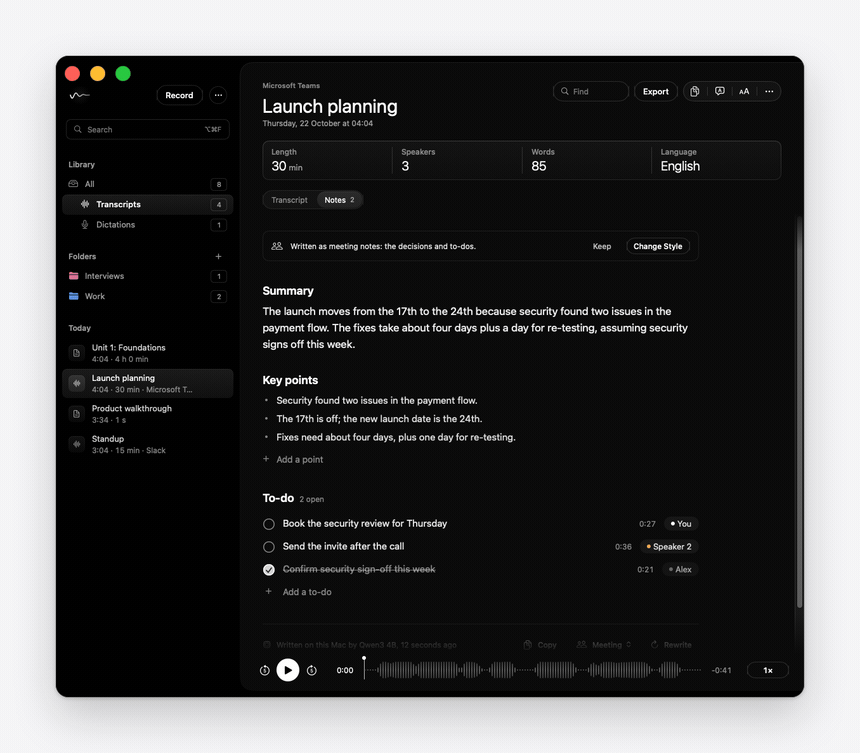

Each style fills the same three parts with what matters for that kind of conversation:

| Style | Points | To-dos |
| --- | --- | --- |
| **Meeting** | Decisions, numbers and dates | What someone agreed or was asked to do |
| **Lecture** | Definitions, formulas and examples, in the order taught | Readings, exercises and deadlines |
| **Interview** | Answers and opinions, with telling phrases in quotes | Follow-ups someone agreed to |
| **One-to-one** | Updates, feedback, blockers and career | Next steps either person agreed to |

Hush picks the style from how the conversation went and says why over the notes. To change it, click the style beside **Rewrite** at the foot of the notes and choose another under **Rewrite As**; ⌘Z brings back the notes it replaced.

**Make your own** in **Settings › Notes › Note styles** with **Add Style**: give it a name and say, in your own words, what the notes should cover, such as "every definition and formula, written out, and anything that sounded like it will be on the exam". **Style for new notes** can make it the one every transcript starts with.

### Translation

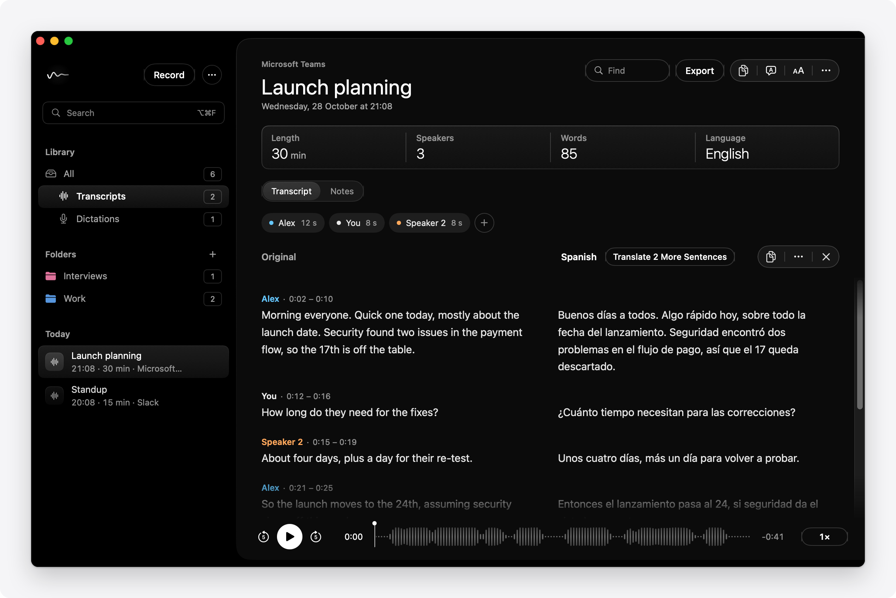

**Translate** shows a translation beside the transcript, sentence by sentence, in any of 28 languages, and translates the notes too. The notes model does it on your Mac. Translations stay with the transcript, and you can export either language.

### Flags, search and folders

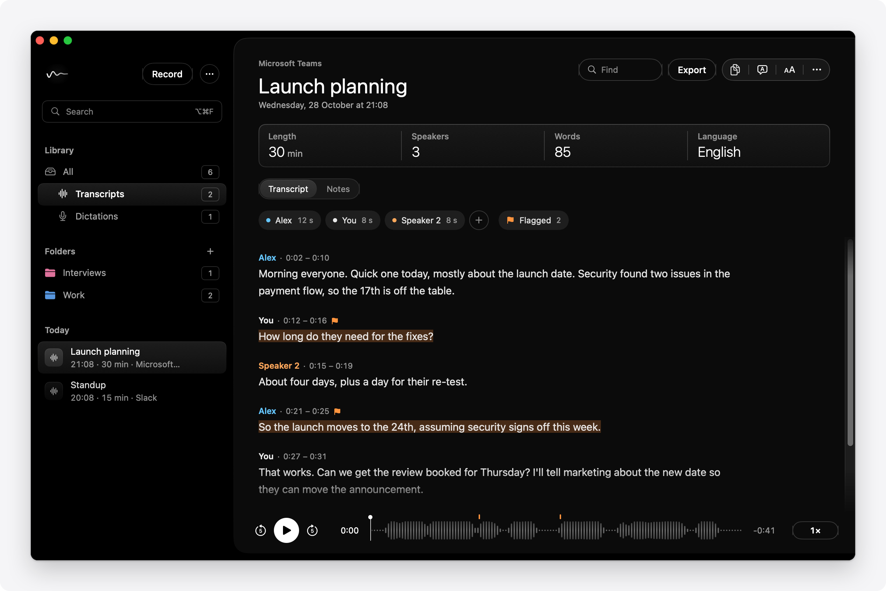

- **Flags.** Flag a sentence while recording (⌃⌥F) or afterwards (⇧⌘F, or right-click it). The **Flagged** chip highlights flagged sentences and steps through them; flags show on the waveform, and exports list them.
- **Search.** The search field at the top of the sidebar (⌥⌘F) searches every transcript, titles first, then what was said. Inside a transcript, **Find** (⌘F) finds a word and ⌘G the next.
- **Folders.** Make one with the + beside **Folders** (⇧⌘N) and drag transcripts onto it. Right-click a folder to colour, export or delete it (deleting keeps what's in it). Select several transcripts with ⌘-click or ⇧-click to move, export or delete them together. Drag a transcript into Finder to save it as a text file.
- **Video.** A video's transcript shows the picture under the speakers, with the sentence being spoken as its caption. It gets smaller as you scroll.

### Export

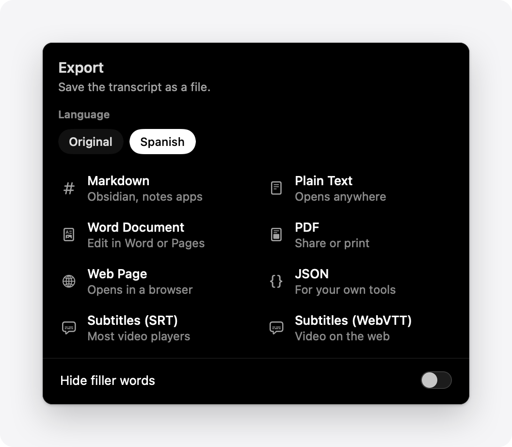

**Export** (⇧⌘E) saves a transcript as Markdown, plain text, a Word document, PDF, a web page, JSON, or SRT and WebVTT subtitles. **Include the notes** puts the notes before the transcript; **Hide filler words** leaves out um and uh. Export several transcripts, or a folder, and each is saved as a file of its own.

To keep a copy of every new transcript in a folder, such as an Obsidian vault or iCloud Drive, choose one under **Export new transcripts** in **Settings › Storage**. Each copy is kept up to date as you edit.

### Recently Deleted

Deleting a transcript moves it to **Recently Deleted** straight away; ⌘Z or **Recover** brings it back. Deleted transcripts are kept, audio and all, for 7 days (1, 7 or 30 in **Settings › Storage**), then permanently deleted. **Empty…** clears it now.

## Ask Claude (MCP)

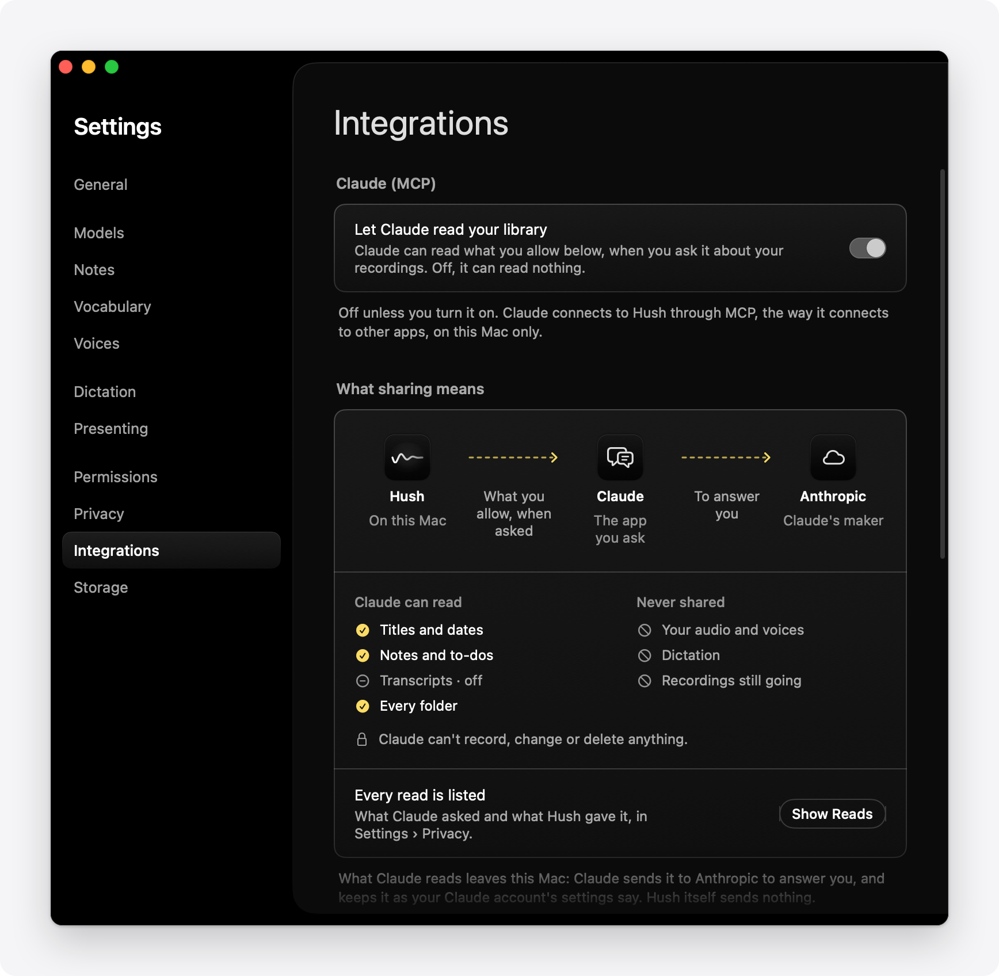

Off unless you turn it on; nothing turns it on but you. Once it's on, Claude answers from your library: "What did we decide about the launch?", "What's still on my to-do list from this week's calls?"

Turn on **Let Claude read your library** in **Settings › Integrations**, click **Add to Claude** and reopen Claude (for Claude Code, run the command shown there once). Claude connects to Hush through MCP, on your Mac only. Turn the switch off and Claude can read nothing, even with Hush added.

- **What Claude can read:** titles, dates, notes and to-dos; transcripts only if you turn them on. A folder you switch off is hidden from Claude.
- **What it can't:** your audio, voices and dictation, or a call still recording. It can't record, change or delete anything.
- **Where it goes:** what Claude reads leaves your Mac for Anthropic, to answer you, and is kept as your Claude account's settings say. Hush itself sends nothing.
- **Every read listed** in **Settings › Privacy**, with what Claude asked and what Hush gave it.

**Block all internet access**, in **Settings › Privacy**, turns it off and keeps it off.

## Vocabulary

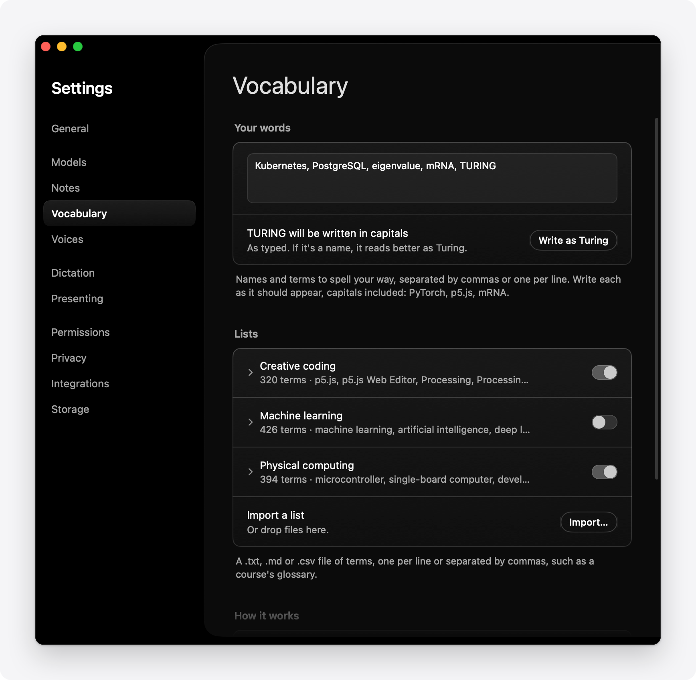

A speech model writes what it thinks it heard, so names and jargon it doesn't know come out wrong: "ML five JS" for ml5.js. Vocabulary is a list of names and terms for Hush to spell your way, capitals included.

In **Settings › Vocabulary**, type your own words, separated by commas or one per line, as they should appear: PyTorch, p5.js, mRNA. Or import lists: a `.txt`, `.md` or `.csv` file of terms, such as a course's glossary, and switch each on or off for what you're recording. Hush gives the speech model the terms each part of a recording seems to need, so long lists are fine. It helps with spelling, but can't make the model hear a word that wasn't said, and with long lists on, files take about a quarter longer.

Three lists made for teaching are in [`vocabulary/`](https://github.com/IrtizaNasar/Hush/tree/main/vocabulary): [creative coding](https://github.com/IrtizaNasar/Hush/blob/main/vocabulary/creative-coding.md) (about 320 terms), [machine learning](https://github.com/IrtizaNasar/Hush/blob/main/vocabulary/machine-learning.md) (about 430) and [physical computing](https://github.com/IrtizaNasar/Hush/blob/main/vocabulary/physical-computing.md) (about 390). Download one with GitHub's **Download raw file** button, then **Import…** it in Settings. To share a list of your own, see [CONTRIBUTING.md](https://github.com/IrtizaNasar/Hush/blob/main/CONTRIBUTING.md).

## Settings

Open Settings with ⌘, or from the menu bar icon. ↑ and ↓ move between tabs.

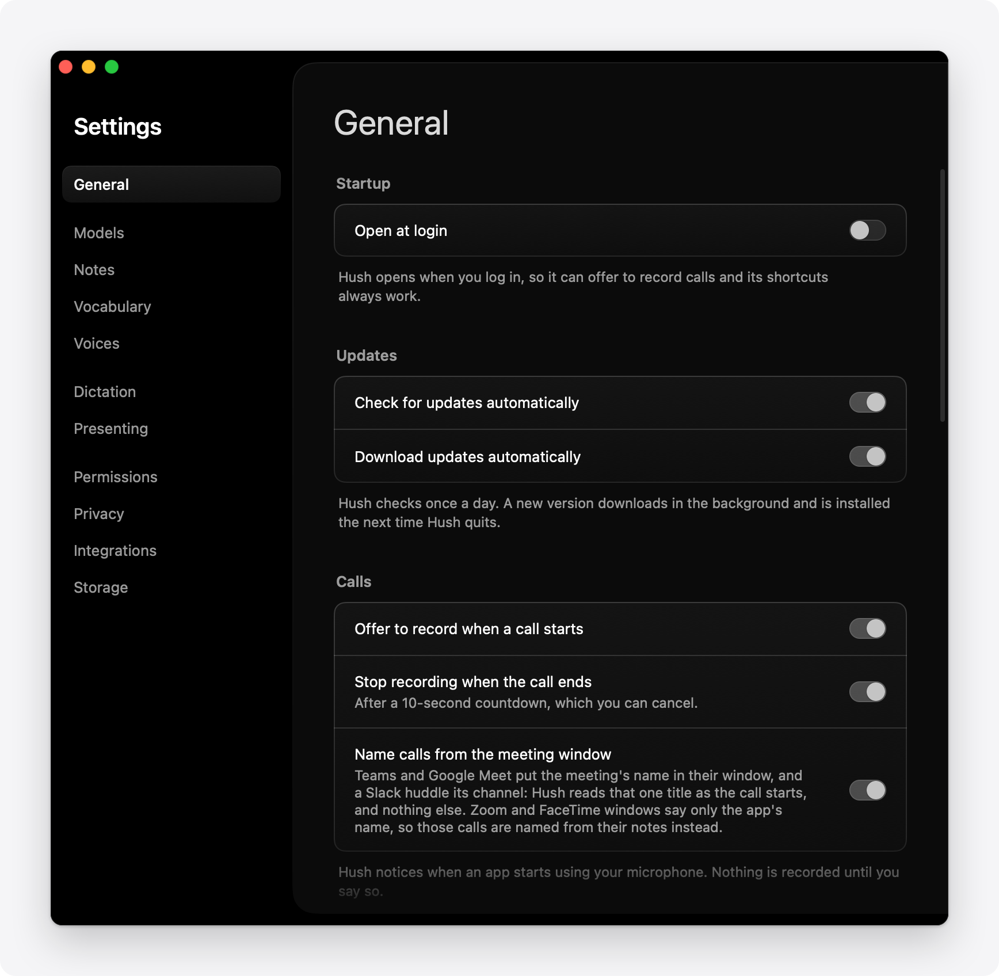

| Tab | What's there |
| --- | --- |
| **General** | Open at login, updates, the offer to record, stopping when a call ends, naming calls from the meeting window, the apps recorded automatically, background work at half speed while you use other apps, hiding Hush in screenshots, the command bar's shortcut, the flag shortcut, the transcript language, speaker labels, filler words and the microphone |
| **Models** | The speech model (Whisper Large v3 Turbo, Medium, Small or Base), whether to transcribe each call again afterwards and with which model (Whisper Large v3 is the most accurate, and about twice as slow), and the link tools |
| **Notes** | The notes model, writing notes automatically, naming transcripts from their notes, the style for new notes, and your own styles |
| **Vocabulary** | Your own words and imported lists |
| **Voices** | Whether Hush learns your voice from calls, and the voices it knows by name |
| **Dictation** | The shortcut, typing into the app you're using, keeping the text on the clipboard, and Accessibility |
| **Presenting** | Which screen the captions use, their size, alignment and position, a preview, captioning what your Mac plays, and saving talks as transcripts |
| **Permissions** | The microphone, system audio and Accessibility, each with a button to allow it |
| **Privacy** | Every time Hush went online, what was sent and where to, a 30-day strip, each Claude read, and Block all internet access |
| **Integrations** | Claude (MCP) |
| **Storage** | What takes up space, recording by recording; how long to keep recordings; moving the library; a backup of your voices, words and styles; Recently Deleted; the watched folder; exporting new transcripts |

## Keyboard shortcuts

**Help › Keyboard Shortcuts** (⌘/) lists them in Hush. The first three work in any app, and you can change them in Settings.

| Anywhere | Keys |
| --- | --- |
| Open the command bar | ⌃⇧Space |
| Dictate: hold, or tap to start and stop | ⌃⌥D |
| Flag the moment, while recording | ⌃⌥F |
| Start Recording, or Stop and Save | ⌘R |
| Pause or Resume | ⇧⌘R |

| Library | Keys |
| --- | --- |
| Choose the transcript above or below | ↑ ↓ |
| Choose several | ⇧↑ ⇧↓ |
| Rename, delete | ↩ ⌫ |
| Switch between the list and the transcript | ⇥ |
| New Folder | ⇧⌘N |
| Search all transcripts | ⌥⌘F |
| Leave a folder or Recently Deleted | Esc |
| Hide or show the sidebar | ⌃⌘S |

| Transcript | Keys |
| --- | --- |
| Play or pause | Space |
| Back or forward 5 seconds | ← → |
| Previous or next sentence | ↑ ↓ |
| Edit the chosen sentence | ↩ |
| Give the sentence to speaker 1 to 9 | 1 – 9 |
| Flag the sentence | ⇧⌘F |
| Find, next, previous | ⌘F ⌘G ⇧⌘G |
| Copy what's selected, or the whole transcript | ⌘C ⇧⌘C |
| Export | ⇧⌘E |
| Write or rewrite notes | ⌘↩ |
| Transcript or Notes | ⌘1 ⌘2 |
| Paragraphs, Conversation, Lines | ⌥⌘1 ⌥⌘2 ⌥⌘3 |
| Bigger or smaller text | ⌘+ ⌘− |

| Windows and files | Keys |
| --- | --- |
| Library | ⌘0 |
| Settings | ⌘, |
| Transcribe Files… | ⌘O |
| Transcribe from Link… | ⇧⌘L |
| Keyboard Shortcuts | ⌘/ |
| Full Screen | ⌃⌘F |

## Privacy in detail

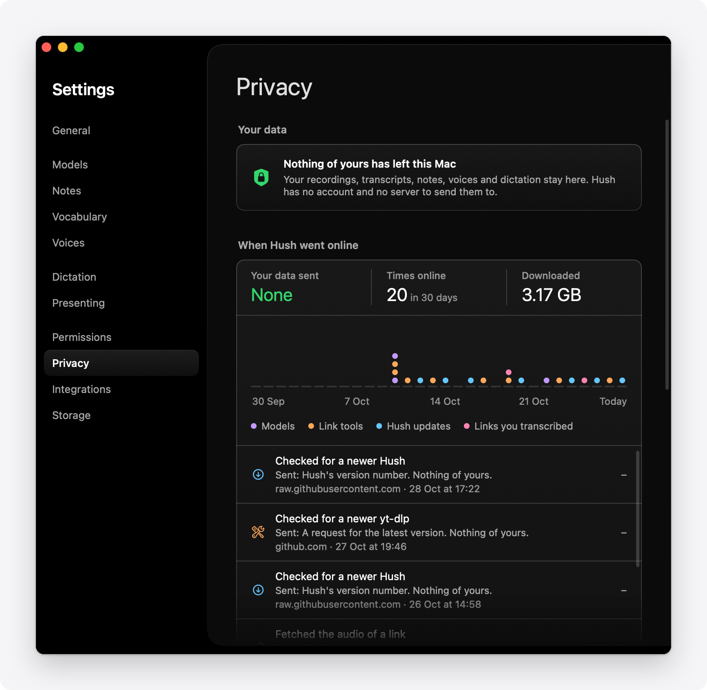

Hush goes online only to download what it runs, check for updates, and fetch a link you give it.

| What | From | When |
| --- | --- | --- |
| Speech models | Hugging Face: [whisper.cpp's models](https://huggingface.co/ggerganov/whisper.cpp) | Once, in setup or when you choose another. Hush also fetches Whisper Small and its Neural Engine encoder (350 MB) for live lines during calls, and may fetch Whisper Base (60 MB) for live previews, by itself when the disk has room |
| Voice detection (885 KB) | Hugging Face: [whisper.cpp's voice detector](https://huggingface.co/ggml-org/whisper-vad) | Once, with the first speech model |
| Speaker models (14 MB) | Hugging Face: [FluidAudio's speaker models](https://huggingface.co/FluidInference/speaker-diarization-coreml) | Once, with the speech model |
| Notes models | Hugging Face: [Qwen3 4B](https://huggingface.co/unsloth/Qwen3-4B-Instruct-2507-GGUF) or [Qwen3 8B](https://huggingface.co/Qwen/Qwen3-8B-GGUF) | Once, in setup or when you choose another |
| yt-dlp | [yt-dlp's GitHub releases](https://github.com/yt-dlp/yt-dlp/releases) | Once, then a check for a new version once a day |
| ffmpeg | [Martin Riedl's builds](https://ffmpeg.martin-riedl.de), the Mac builds ffmpeg.org lists | Once |
| Hush's updates | The [releases](https://github.com/IrtizaNasar/Hush/releases) and update feed | A check once a day, and the new version when there is one |
| The page you paste | That site | When you transcribe from a link |

Each link tool is checked against the checksum its maker publishes before Hush uses it.

**Check for yourself.** **Settings › Privacy** lists every time Hush has gone online. A firewall app such as [Little Snitch](https://www.obdev.at/products/littlesnitch/) or [LuLu](https://objective-see.org/products/lulu.html) shows each connection any app makes. Hush needs only `huggingface.co` and the servers it sends downloads to (`*.huggingface.co`, `*.hf.co`), `github.com` and `*.githubusercontent.com`, `ffmpeg.martin-riedl.de`, and the site of a link you paste. Block them all once setup is done and Hush still records, transcribes and writes notes; only links and updates stop.

**Block all internet access**, at the foot of **Settings › Privacy**, makes no connection at all, as if the Mac had no internet, and greys out what needs one. Claude (MCP) is off while it's on.

**Claude (MCP).** Hush makes no connection for this: Claude starts a small helper inside Hush, which talks to Hush over a connection on your Mac that only you can open, and only while the switch is on. Nothing listens on the network.

**Your data.** Transcripts, recordings and notes are kept in `~/Library/Application Support/Hush`, with the models in its `Models` folder. **Settings › Storage** moves the library to another folder or drive. To keep less: **Delete recordings after** a week, a month, a year or a time you choose (transcripts and notes stay; files you added are never deleted, only Hush's copy of their sound); **Remove Recording Only** deletes one recording and keeps its text; turning off **Keep recordings** keeps only the text.

## Limits

- Hush needs macOS 14.2 or later and a Mac with Apple silicon.
- Transcripts aren't perfect. Names and jargon can come out wrong; Vocabulary helps, but can't make the model hear a word that wasn't said.
- Speaker labels can be wrong, especially when people talk over each other or sound alike. **Look for More Speakers**, **Find Speakers Again** and the number keys put it right.
- Live sentences are a first draft; the transcript settles after the call, about 6 minutes per hour of call.
- Captions trail your voice by about a second and a half.
- **Hide Hush in screenshots** works for screenshots only. Screen recordings and shared screens still show the notch panel and the command bar, and on macOS 15 and later some screenshots may too.
- Qwen3 8B needs 16 GB of RAM, and notes for an hour-long call take a few minutes.
- Telling voices apart in a very long recording takes a lot of memory: Hush does it without asking for up to about 6 hours on an 8 GB Mac, 14 on 16 GB and 30 on 32 GB, and asks first beyond that.
- With the lid closed, your Mac's own microphone is off. A recording pauses when your Mac sleeps.
- Dictation types into other apps only with Accessibility allowed.
- Videos a site protects from downloading can't be transcribed from a link.
- A recording needs about 250 MB of free space an hour while it's being made.
- Other apps at the notch (Loophole, NotchNook): while Hush's panel is up it sits on top. **Hide for This Session** keeps the notch clear during a recording.
